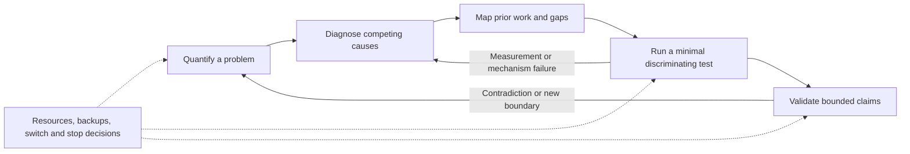

# Research Closed Loop

[中文说明](README.zh-CN.md) · [Complete workflow](docs/workflow.md) · [Example scenarios](examples/scenarios.md)

An observation-led, evidence-aware research skill collection for Codex: **one router and six focused stages**, taking a project from a measurable problem to defensible evidence and a resource-aware next decision.

It helps answer: **What is actually wrong? What explanation fits? What already exists? What is the cheapest useful test? What can the results support? When should we revise or stop?**

This is an instruction-and-template package, not a training framework, an autonomous lab, a paper generator, or a guarantee of novelty/publication. It can also help start from a topic without data, while keeping the pain point and proposed mechanism provisional. Theory-led and exploratory research need not manufacture an observed anomaly.

## Architecture and flow



The arrows describe research decisions, **not automatic execution**. Stages can overlap, be skipped when irrelevant, or loop back. A negative result can be a useful exit rather than a reason to add more modules.

| Skill | Use it when | Main output |
|---|---|---|
| [`research-closed-loop`](skills/research-closed-loop/SKILL.md) | You need the full loop or the next stage | Stage assessment, next informative action, return/stop conditions |
| [`research-problem-localization`](skills/research-problem-localization/SKILL.md) | Observations are vague or unverified | Problem card with metric, denominator, strata, boundaries, and impact |
| [`research-bottleneck-diagnosis`](skills/research-bottleneck-diagnosis/SKILL.md) | The cause is uncertain | Competing hypotheses and discriminating controls/ablations |
| [`research-gap-mapping`](skills/research-gap-mapping/SKILL.md) | You need prior-work positioning | Claim–source–conditions map, bounded gap, substantive method distinction |
| [`research-minimal-prototype`](skills/research-minimal-prototype/SKILL.md) | A mechanism needs cheap validation | Minimal test with continue/revise/stop criteria and budget |
| [`research-validation-design`](skills/research-validation-design/SKILL.md) | A pilot needs stronger evidence | Fair baselines, independent evaluation, ablations, uncertainty, limits |
| [`research-portfolio-management`](skills/research-portfolio-management/SKILL.md) | Directions compete for limited resources | Main/backup choices, shared risks, allocation and switching conditions |

Each stage is usable independently. The router reads only relevant stages; it does not load all references or impose a mandatory reporting bureaucracy.

## Install

Clone this repository into a location of your choice. Install **all seven sibling directories** so the router's relative links remain valid. Choose **one language**: installing both under the same discovery root creates duplicate skill names.

```bash
git clone https://github.com/Ash-end/research-closed-loop.git
cd research-closed-loop

# Preview first; replace the destination with your project's skills directory.
python scripts/install.py --dest /path/to/project/.agents/skills --language en --dry-run
python scripts/install.py --dest /path/to/project/.agents/skills --language en
```

Windows example, using a generic project path rather than a user-specific location:

```powershell
python .\scripts\install.py --dest 'F:\MyResearchProject\.agents\skills' --language zh --dry-run
python .\scripts\install.py --dest 'F:\MyResearchProject\.agents\skills' --language zh
```

The installer uses Python 3.10+ and its standard library. It refuses existing destination skill entries, symlinked package files, and destination paths inside this repository; it does not replace skills or modify application data. Installation is not fully transactional against a mid-copy disk failure: inspect any reported incomplete destination before retrying. Alternatively, manually copy the seven folders from `skills/` (English) or `locales/zh-CN/skills/` (Chinese) into a supported skill-discovery location. A junction/symlink is optional, not required.

Codex discovery and UI refresh behavior depend on the host/version. Follow the [official skill documentation](https://developers.openai.com/codex/skills/); open a new chat or refresh discovery if needed. These files do not install a Codex plugin or a permission sandbox. Other agents may use the Markdown instructions, but their loaders and UI metadata require separate compatibility checks.

## Use in Codex

```text
Use $research-closed-loop.

Topic: ...
Observed behavior or current results: ...
Relevant project artifacts: ...
Available time/data/compute: ...

Identify the current stage and the most informative next test.
This request is analysis and design only; do not start training.
```

Or call a stage directly:

```text
Use $research-bottleneck-diagnosis to compare explanations for these
results and design the lowest-cost experiment that distinguishes them.
```

Only a topic? Ask for an operational task definition, data/annotation preparation, and a minimal observation plan. Returning to a project? Supply its current state/results; ask to update the decision rather than restart all six stages. When you want actual implementation or execution, explicitly state the project, permitted actions, resource limits, and stopping conditions.

## What the loop preserves

- **Problem before solution:** quantify the discrepancy and practical cost; check labels, metrics, and pipeline faults first.
- **Mechanism and alternatives:** intervention delivery, mediator change, and final score are different evidence.
- **Evidence-grounded novelty:** locating a paper is not support for a claim, and not finding one is not proof of absence.
- **Cheap discriminating tests:** a pilot may be a derivation, counterexample, measurement check, or small experiment—not necessarily a network.
- **Fair confirmation:** separate development selection from untouched evaluation; disclose overlap, budgets, variance, failures, and limits.
- **Resource-aware exits:** two or three lines are optional, not a quota; one main line plus a written backup may be enough.

“80% of misses are small targets” is not “small targets have an 80% miss rate.” Ablations do not automatically prove causation; multi-dataset wins do not prove universal generalization; every component need not be useful. See [interpretation boundaries](skills/research-closed-loop/references/decision-boundaries.md).

## Outputs and persistence

Optional templates are included for project state, problem localization, diagnosis, gap evidence, pilots, validation, and portfolio decisions. Adapt them to existing project notes; do not create every artifact for every request. Saved records make resumption easier, but there is no scheduler, background monitor, or autonomous continuation.

Detailed stage inputs, procedures, outputs, and return points are in the [full workflow guide](docs/workflow.md). The [examples](examples/scenarios.md) use synthetic inputs, never private project data.

## Languages, dependencies, and checks

- `skills/`: complete English instructions, templates, references, and UI metadata.
- `locales/zh-CN/skills/`: complete Chinese alternative, with the same seven skill names and boundaries.
- No paid model API, MCP server, external skill, or scientific Python package is required by the skills themselves. Real search, data analysis, and experiments still need appropriate tools/data and authorization.
- Developer checks use Python 3.10+ and PyYAML: `python -m pip install -r requirements-dev.txt`, then `python scripts/validate.py` and `python -m unittest discover -s tests -v`.

The original design was exercised on six synthetic scenarios and three follow-up scenarios; this is limited behavioral evidence, not a benchmark of scientific productivity. Packaging checks do not prove that every agent/model will reason correctly. See [validation scope](docs/validation.md).

## Safety and scope

Plans do not authorize training, code modification, paid calls, remote jobs, extra agents, or public submissions. Stay within the current user request and budget; retain negative results and use bounded retries. Keep research methods separate from competition award criteria, marketing goals, and language-teaching standards. These are routing rules, not process/permission isolation. Projects involving people, animals, sensitive data, or hazardous interventions additionally require the appropriate ethics, legal, and domain-specific review.

## License and provenance

[MIT](LICENSE). Created from an observation-led research workflow and refined through synthetic scenario checks; no third-party skill implementations are vendored. Methodological references are attributed in [method sources](skills/research-closed-loop/references/method-sources.md). Linked publications and external assets retain their own licenses. Do not commit unpublished data, credentials, private logs, or identifiable records when adapting this repository.
