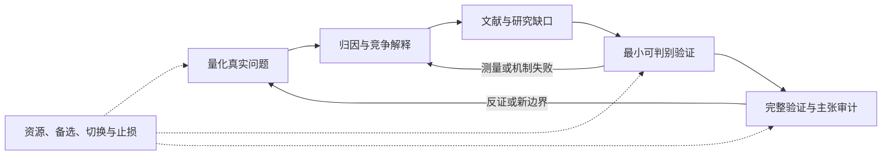

# Research Closed Loop｜观测驱动科研闭环

[English](README.md) · [完整流程详解](docs/workflow.zh-CN.md) · [场景示例](examples/scenarios.zh-CN.md)

一套用于 Codex 的科研技能：**一个总入口＋六个阶段技能**。从真实现象出发，定位问题、区分原因、检索前作、低成本试错、建立完整证据，再决定继续、修改、转向还是停止。

它要解决的不是“帮我凑一个新模型”，而是：**问题到底是什么？解释是否成立？前人做到了什么？下一项最便宜且有信息量的验证是什么？结果能支持多强的结论？**

这是指令与模板集合，不是训练框架、自动科研机器人、论文生成器，也不保证创新、录用或性能提升。没有数据、只有主题时也能开始，但痛点和机制保持待验证。理论、探索性或假设驱动研究不必强行制造实验异常。

## 一、整体结构与作用



箭头表示研究决策，**不代表自动运行实验**。阶段可以交叉、跳过不相关部分或回退；负结果可以成为有价值的出口，而不是不断加模块的理由。

| 技能 | 什么时候用 | 主要交付 |
|---|---|---|
| [`research-closed-loop`](locales/zh-CN/skills/research-closed-loop/SKILL.md) | 不清楚当前阶段，或需要完整闭环 | 阶段判断、下一项验证、回退与停止条件 |
| [`research-problem-localization`](locales/zh-CN/skills/research-problem-localization/SKILL.md) | 现象模糊、问题未经复核 | 带指标、分母、分层、边界与代价的问题卡 |
| [`research-bottleneck-diagnosis`](locales/zh-CN/skills/research-bottleneck-diagnosis/SKILL.md) | 不知道真正瓶颈 | 竞争假说、控制/消融和区分性测试 |
| [`research-gap-mapping`](locales/zh-CN/skills/research-gap-mapping/SKILL.md) | 需要梳理前作与创新空间 | 主张—来源—条件映射、有限范围的 gap、方法本质差异 |
| [`research-minimal-prototype`](locales/zh-CN/skills/research-minimal-prototype/SKILL.md) | 有想法，尚不值得重工程投入 | 最小测试、资源预算、继续/修订/停止条件 |
| [`research-validation-design`](locales/zh-CN/skills/research-validation-design/SKILL.md) | 原型值得深入，或需要审计已有证据 | 公平基线、独立评估、消融、不确定性和局限 |
| [`research-portfolio-management`](locales/zh-CN/skills/research-portfolio-management/SKILL.md) | 主线受阻，多个方向竞争资源 | 主线/备选、共同风险、分配与切换条件 |

阶段技能可独立使用。总入口按需加载，不要求每次读完所有参考文件，也不强制建立复杂记录体系。

## 二、安装

克隆仓库后，把七个兄弟目录一起安装，保持总入口的相对链接有效。**英文和中文选一套**，不要在同一发现目录安装两套同名技能。

```bash
git clone https://github.com/Ash-end/research-closed-loop.git
cd research-closed-loop

python scripts/install.py --dest /path/to/project/.agents/skills --language zh --dry-run
python scripts/install.py --dest /path/to/project/.agents/skills --language zh
```

Windows 示例使用通用项目路径，请替换成自己的目录：

```powershell
python .\scripts\install.py --dest 'F:\MyResearchProject\.agents\skills' --language zh --dry-run
python .\scripts\install.py --dest 'F:\MyResearchProject\.agents\skills' --language zh
```

安装脚本使用 Python 3.10+ 标准库，遇到已有同名入口、包内符号链接或仓库内部目标路径时拒绝安装，不覆盖旧技能，不改应用数据。它不能保证磁盘中途故障时的完整事务回滚；出现复制失败应先检查残留再重试。

也可以手动复制 `skills/` 的七个英文目录，或 `locales/zh-CN/skills/` 的七个中文目录，放到宿主支持的技能发现位置。目录链接只是可选兼容方式，不是必须步骤。

Codex 的发现位置与界面刷新取决于版本和宿主，请参照[官方技能文档](https://developers.openai.com/codex/skills/)。必要时新开对话或刷新技能列表。本仓库不是 Codex 插件或安全沙箱；其他代理可阅读 Markdown，但其加载器和界面元数据需要另行检查兼容性。

## 三、具体怎么用

```text
使用 $research-closed-loop。

我的方向：……
观察到的现象/已有结果：……
相关项目材料：……
时间、数据和计算资源：……

判断当前处于哪个阶段，给出最有信息量的下一项验证。
本次仅分析与设计，不启动训练。
```

只需要归因时：

```text
使用 $research-bottleneck-diagnosis，
比较这些结果的竞争解释，设计最便宜的区分实验。
```

只有主题时，请它先定义具体任务、准备数据/标注与测量方案。接着上次研究时，提供当前项目状态和结果，让它更新判断，而不是重新走六阶段。希望实际执行时，再明确项目范围、允许动作、资源上限和停止条件。

## 四、这套流程真正强调什么

1. **问题优先**：有指标、分母、边界和实际代价，先排除测量、标签和管线问题。
2. **归因先行**：比较竞争解释；干预生效、中介变化和最终分数是不同证据。
3. **gap 有证据**：检索到论文不等于支持主张，没检索到也不等于没有前作。
4. **低成本判别**：原型可以是推导、反例、复核或小实验，不必先训练新网络。
5. **公平确认**：开发选择与独立确认分开，披露数据重叠、资源、波动、失败和局限。
6. **资源适配**：2–3 条方向不是硬性配额，一条主线加书面备选也可以。

特别注意：“80% 的漏检来自小目标”不是“小目标漏检率为 80%”；消融不自动证明因果；多数据集提升不证明普遍泛化；每个组件也不必都有效。详见[判读边界](locales/zh-CN/skills/research-closed-loop/references/decision-boundaries.md)。

## 五、输出与持续记录

提供项目状态、问题卡、归因矩阵、文献证据矩阵、原型计划、验证协议和方向看板模板。按任务裁剪，优先复用已有笔记，不要求每次生成全部文件。

保存记录有助于断点继续，但本仓库没有定时器、后台监控或自动续跑。各阶段的输入、动作、产物与出口详见[完整流程](docs/workflow.zh-CN.md)；[示例](examples/scenarios.zh-CN.md)全部使用模拟输入，不含私人科研数据。

## 六、语言、依赖与检查

- `skills/`：完整英文指令、模板、参考文件和界面元数据。
- `locales/zh-CN/skills/`：完整中文替代版；技能名称和证据边界一致。
- 技能本身不依赖付费模型、MCP、外部科研技能或科学计算包。真实检索、分析和实验仍需要相应工具、数据和执行权限。
- 开发检查使用 Python 3.10+ 与 PyYAML：`python -m pip install -r requirements-dev.txt`，之后运行 `python scripts/validate.py` 和 `python -m unittest discover -s tests -v`。

初始设计做过六个模拟场景试用和三个修订后复测。这是有限的判断行为验证，不是科研产出评测；格式或打包检查也不保证所有模型都推理正确。详见[验证范围](docs/validation.md)。

## 七、安全、许可与来源

设计方案不等于授权训练、改代码、调用付费接口、运行远程任务、额外代理或公开投稿。按本次请求与预算执行，保留负结果，重试有上限。科研方法不混用竞赛获奖标准、自媒体目标或语言教学规范；这种分类不是进程或权限隔离。涉及人、动物、敏感数据或危险干预的项目，还需对应伦理、法律与专业审查。

采用 [MIT 许可证](LICENSE)。本集合根据观测驱动科研流程设计并经模拟场景修订，没有收录第三方技能实现；方法资料在[来源说明](locales/zh-CN/skills/research-closed-loop/references/method-sources.md)中署名。外部论文和资产仍适用各自许可。请勿把未公开数据、密钥、私人日志或可识别记录提交到自己的公开版本。
